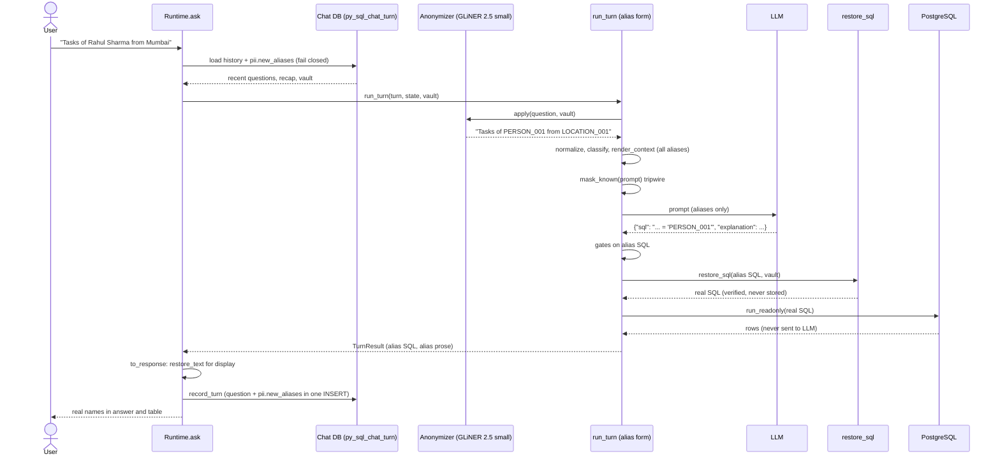

# PII aliasing: keeping personal data away from the LLM

**Status: built (2026-11-02), switched off by default.** Set `PII_ALIASING=true`
in `.env` to turn it on (§0). Sections 1-10 are the design as approved. The
places where the build differs from it are listed in §0.3.

The aim is a privacy layer around the SQL chatbot. The LLM works only with
aliases such as `PERSON_001`. The backend puts the real values back just
before the SQL runs. The user never notices the difference.

Every claim carries a tag:

| Tag | Meaning |
|---|---|
| **[Implemented]** | True of the code today, checked by reading it (file and line given). |
| **[Proposed]** | Part of this design. Not written yet. |
| **[Needs validation]** | An assumption that must be checked before or during implementation. |

Entity detection uses `fastino/gliner2.5-small-v1`. That is the model the GLiNER
playground (`presidio-playground/app.py`) now runs, and it is benchmarked in
`presidio-playground/benchmark/FINAL_REPORT.md`.

---

## 0. What was built

### 0.1 Turning it on

1. `pip install -r requirements.txt` adds `gliner2[local]==2.1.0`. torch and
   transformers already come with `wrenai[memory]`.
2. Saved chats must be configured (`HISTORY_DATABASE_*`), because each chat's
   aliases are stored with its turns. The server refuses to start with
   aliasing on and no chat database.
3. In `.env`:

   ```
   PII_ALIASING=true
   PII_MODEL=fastino/gliner2.5-small-v1   # the model is only a name: change it here
   PII_THRESHOLD=0.5
   PII_CONCURRENCY=4
   ```

4. What counts as personal, the fixed words, and the words never masked are
   in `config/pii_entities.json`. It has the same shape as the GLiNER
   playground's `entities_config.json`.

At startup the server prints `PII aliasing: on (…)` and loads the model,
which takes about 17 s.

### 0.2 Files

| File | What it does |
|---|---|
| `pipeline/pii.py` (new) | `PiiVault`, `Anonymizer`, `restore_sql`, `restore_text`, `mask_known`, `PiiGuard` |
| `config/pii_entities.json` (new) | Labels, label expansions, custom words, never-mask words |
| `pipeline/lean_runner.py` | Layer 1 at the top of `run_turn`; Layer 2 in `_execute` (main, early, chart, repair); tripwire on both `provider.ask` calls; `run_suite` keeps a vault per conversation |
| `scripts/serve_api.py` | Builds the vault per turn from the chat database and refuses when it cannot (`Runtime.pii_guard`); legacy-history screening; display restore (`displayed`); reset on a failed save; restore in `present_chat` and `full_csv` |
| `pipeline/chat_store.py` | `load` returns `ok`, `aliases` and the `screened` flags; `record_turn` returns whether it wrote; `metadata_for` writes `pii.new_aliases` and never sheds it |
| `pipeline/redact.py` | `names_a_database_object` ignores aliases (§0.3) |
| `config/settings.py`, `.env.example`, `requirements.txt` | `PII_*` settings, the startup check, the dependency |
| `scripts/pii_eval.py` (new) | Over-masking rate and canary catch rate on real questions, with no LLM |
| `tests/test_pii.py`, `tests/test_pii_pipeline.py`, `tests/test_pii_model.py` (new) | 74 tests (§0.4) |

### 0.3 Where the build differs from the design, and why

1. **The alias instruction is not in the system prompt.**
   - The system prompt is compared byte for byte with the PHP port, so a line
     added there would break parity.
   - `PLACEHOLDER_NOTE` goes at the top of the per-turn context block, and at
     the top of the repair prompt.
   - It is sent only when the prompt carries an alias, at a cost of about 90
     tokens.
2. **Only our prefixes count as aliases.**
   - The generic pattern `[A-Z]+_\d{3}` also matches real stored values such
     as `WF_001`. Those would have been refused as "unknown aliases".
   - The pattern now covers PERSON, EMAIL, LOCATION, COMPANY, VENDOR, AGE,
     PHONE, and any prefix a configured label adds.
3. **The identifier guard ignores aliases.**
   - `names_a_database_object` treats snake_case as a column name, and
     `PERSON_001` is snake_case.
   - Left as it was, it dropped every model sentence that carried an alias:
     - the explanation was dropped;
     - the clarification was replaced with a generic question;
     - clarification options were dropped;
     - the recap was rejected, so the thread lost its memory.
   - Aliases are now taken out before the check. Schema names are lowercase,
     so no real identifier can hide this way.
   - The PHP port has no aliases, so parity is unaffected.
4. **Values the vault already knows are matched exactly, before the model
   runs.**
   - A name aliased on turn 5 keeps PERSON_001 on turn 8 even if the model
     misses it on turn 8.
   - A clicked chip whose label shows the real name maps back to the same
     alias.
5. **Older chats are screened when loaded.**
   - Turns saved before aliasing was on have no `pii` key.
   - Their questions and recap are anonymized when the history is rebuilt,
     before any prompt holds them.
6. **Pronouns and the small model's frequent false hits are never masked.**
   - `config/pii_entities.json` lists pronouns, plus `SLA`, `attachments`,
     `file uri`, `workflow code` and others.
   - The schema vocabulary (table and column names, whole and in parts, and
     their listed values) is skipped automatically.
7. **A value that names a write is refused.**
   - The read-only gate's keyword check reads inside string literals too. So
     a name such as `a'; DROP TABLE …` is refused rather than run, even
     though it is quoted correctly. This fails safe.

### 0.4 Verification (2026-11-02)

**Tests: 74 new ones, all passing.**

| File | Count | What it covers |
|---|---|---|
| `tests/test_pii.py` | 47 | Vault, text, the full §4.4 SQL matrix, injection values, detection |
| `tests/test_pii_pipeline.py` | 24 | Whole turns, the repair path, chart and early queries, concurrency, chat store, the server end to end |
| `tests/test_pii_model.py` | 3 | The real model, marked integration |

The pipeline tests include restarting with the chat database left in place:
a new person then gets PERSON_002, never PERSON_001 again.

**Regression:** the full suite runs 984 passed. The 22 failures and errors
are exactly the ones present before this work:
- `test_database.py`, which expects the demo database;
- the `test_stream_endpoint.py` fixture;
- `test_column_order`.

**Real model on 513 real questions** (`scripts/pii_eval.py`):

| Measure | Result |
|---|---|
| Real questions changed by a false detection | 88 (17.2%); the benchmark had 38% before the skip lists |
| Canary person, email, location caught | 50/50 each |
| Canary phone caught | 49/50 |
| Detection time | 59 ms per question |
| Model load | 17 s |

**Live end to end:** real model, real PostgreSQL (read-only), scripted LLM.
The question named a real assignee.

| Check | Result |
|---|---|
| What the model saw | `How many tasks are assigned to PERSON_001?` |
| Stored SQL | `… = 'PERSON_001'` |
| Executed SQL | The real name |
| Count | 1952, equal to a direct query |

**Not yet measured:** answer quality with a real LLM. Run the lean suite
with `PII_ALIASING=true` and again with it off, and compare. This is M7's
remaining half, and it needs LLM calls.

---

## 1. Current architecture

### 1.1 Request to SQL execution

**[Implemented]** The live configuration is `.env`: `LLM_PROVIDER=cli`,
`CLI_LEAN=true`. The path that runs:

```
POST /ask  (scripts/serve_api.py:955)
  └─ Runtime.ask                       serve_api.py:490
       ├─ ChatStore.load(session_id)   rebuilds recent questions + recap from py_sql_chat_turn (529-538)
       ├─ apply_action / option_ref / drop_ref   chip clicks become question text (545-573)
       └─ run_turn                     pipeline/lean_runner.py:581
            ├─ normalize()             typo repair against schema vocabulary (624-631)
            ├─ resolve_clarification() a reply to a clarification becomes the full question (642-660)
            ├─ classify_turn()         regex: new_block / follow_up (663)
            ├─ render_context(state) + render_identity(identity)   (704-722)
            ├─ provider.ask(question, …, session)   the ONE LLM call per turn (736)
            ├─ parse_sql / parse_explanation / parse_recap / …   (749-762)
            ├─ check_against_schema()  gate 1, sqlglot (790-795)
            ├─ assert_read_only()      gate 2, sqlglot, exactly one query (797-814)
            ├─ _execute()  → run_readonly()   psycopg, READ ONLY txn, NO parameters (344-355)
            ├─ _second_attempt()/_repair()    at most one repair LLM call (490-578, 883-927)
            ├─ _run_chart_query()      a second SELECT, through the same gates (358-394)
            └─ update_state(state, question, sql, …)
  └─ to_response()                     serve_api.py:237
  └─ ChatStore.save() + record_turn()  writes py_sql_chat / py_sql_chat_turn (608-615)
```

Facts the design depends on:

- **[Implemented]** One main LLM call per turn. There is no separate intent
  classification and no LLM rewrite of follow-ups: `normalize`,
  `resolve_clarification` and `classify_turn` are all deterministic.
- **[Implemented]** Database rows never reach the LLM. `explanation` is written
  in the same call as the SQL, before the SQL runs. Charts (`chart_for`) and
  follow-up chips (`followup.decide`) are built locally from the rows.
- **[Implemented]** SQL runs as plain text, with literals written by the LLM,
  through `cur.execute(sql)` with no parameters (`database/connection.py:103-161`).
- **[Implemented]** Each SQL execution goes through one of two functions:
  - `_execute` (`lean_runner.py:344`) for the main query, the early streamed
    query, the chart query and the repaired query;
  - `run_readonly` directly in `full_csv` (`serve_api.py:846`), which re-runs a
    stored query for CSV download.
- **[Implemented]** History is rebuilt from the chat database on **every** turn,
  not only after a restart (`serve_api.py:529-538`). The in-memory
  `ConversationState` also keeps fields that the database does not rebuild:
  - `active_filters`
  - `pending_clarification`
  - `active_goal`
  - `previous_sql`
- **[Implemented]** There is no PII code anywhere in the repository.
  `docs/privacy.md` says so: "Question text is not automatically checked for
  data values."

### 1.2 Everything that reaches the LLM today

**[Implemented]**

| Channel | Built in | Can carry PII? |
|---|---|---|
| `Question: …` | `claude/prompts.py:99` | yes: the user's words |
| `RECENT QUESTIONS` (up to 10, 160 chars each) | `pipeline/context.py:554-616` | yes |
| `rolling_recap` (written by the LLM, fed back) | `context.py:554-616` | yes: echoes names |
| `awaiting_answer_to` + options | `context.py:554-616` | yes |
| `dropped_filters` (raw SQL predicates) | `context.py:554-616` | yes: `assigned_user_name = 'Rahul Sharma'` |
| `SIGNED-IN USER` name + departments | `pipeline/identity.py:42-74` | yes: read from `tms_user_flat` |
| Repair prompt: question + failed SQL + PostgreSQL error | `prompts.py:385-409` | yes: the error can echo a literal |
| History mode: replayed `generated_sql` | `prompts.py:88-97` | yes (not the live mode) |
| One-shot CLI fallback puts the prompt in `argv` | `llm_api/cli_provider.py:111-115` | yes, and visible in the process list |

The system prompt (`build_lean_system_prompt`, `prompts.py:358`) is static. It
holds no question text.

### 1.3 Schema facts that shape the design

**[Implemented]** These come from `metadata/schema_description.yaml`:

- **Names are stored whole.** The columns are `tms_user_flat.user_name`,
  `tms_user_department_flat.user_name` and `tms_task_flat.assigned_user_name`.
  An alias that stands for a full name maps straight onto these columns.
- **There are no email, phone or address columns** in the eight described
  tables. Email or phone aliases will rarely appear in valid SQL. The LLM
  should ask for clarification or produce no filter.
- The table in the brief's example, `vf_users_field_data`, is not in this
  schema. The examples below use `tms_task_flat`.

### 1.4 Integration points

| Purpose | Where | Why there |
|---|---|---|
| Layer 1 (anonymize) | top of `run_turn`, before `normalize()` | every later step, and all saved state, sees only aliases |
| Outbound tripwire | the two `provider.ask` call sites (`lean_runner.py:736`, `565`) | the last point before data leaves the process |
| Layer 2 (restore) | inside `_execute`, and in `full_csv` | the only two ways SQL reaches the database |
| Display restore | `to_response` (`serve_api.py:237`) | the only way prose reaches the screen |
| Alias storage | `ChatStore.load` / `ChatStore.record_turn` | already run every turn |

---

## 2. Recommended architecture

### 2.1 The principle

> **The pipeline lives entirely in alias form. Real values exist only at three
> edges: user input, database execution, and the screen.**

Layer 1 converts the question at the point it enters. After that, everything
the pipeline holds is in alias form with no further work:

- the recent-questions window;
- the recap the LLM writes;
- the state's filters (parsed from the LLM's alias SQL);
- the clarification options;
- `generated_sql`, which is stored and logged.

Layer 2 does not try to clean up the pipeline. It turns alias SQL into real SQL
at the database boundary and nowhere else.

### 2.2 Components

All components below are **[Proposed]**. They go in a new module,
`pipeline/pii.py`.

| Component | Responsibility | Uses the model? |
|---|---|---|
| `PiiVault` | Mapping for one chat. Looks up and assigns aliases; rebuilt from the chat database each turn. | no |
| `Anonymizer` | GLiNER 2.5 small plus custom words plus skip lists; turns text into aliased text | yes |
| `restore_sql(sql, vault)` | Puts real values into string literals; refuses anything unsafe (§4) | no |
| `restore_text(text, vault)` | Puts real values into prose for display | no |
| `mask_known(text, vault)` | Replaces any known original with its alias in outgoing text (the tripwire) | no |

The `Anonymizer` reuses the playground's logic:

- `find_custom_words`, `resolve_overlaps` and the never-mask filter from
  `presidio-playground/app.py`, with the same `entities_config.json` shape;
- a skip list built automatically from the table names, column names and
  example enum values in `schema_description.yaml`;
- a skip for any token that already matches the alias pattern, so that
  anonymizing twice changes nothing. This matters for clicked chips, whose
  labels already carry aliases.

It is switched on with **`PII_ALIASING=on|off`** in `.env`. The default is
`off`, so the existing suites and the parity harness run unchanged.

### 2.3 Layer 1: question to aliases

**[Proposed]**

1. At the top of `run_turn`, replace `question = turn.question` with
   `question = anonymizer.apply(turn.question, vault)`.
   - This runs **before** `normalize()`. GLiNER then sees the user's own
     spelling, and `normalize()` already skips capitalised words
     (`normalize.py:291`), so it leaves `PERSON_001` alone.
2. Pre-load the vault with the signed-in user's `display_name` as a person, so
   that the `SIGNED-IN USER` block shows `name: PERSON_00n`.
   - **[Implemented]** The business rules filter "my tasks", "my issues" and
     "my weekly work" by **id** (`assigned_user_id = <the id in the SIGNED-IN
     USER block>`, `metadata/business_rules.yaml:32-58, 225-229`), never by
     name. Aliasing the name therefore changes no SQL.
   - Departments are business units, not personal data. They stay as they
     are. They must: `my_department` writes them into the SQL as quoted
     literals (`business_rules.yaml:59-70`).
3. **Tripwire.** Before each `provider.ask`, run `mask_known()` on the full
   prompt: the question, the context block and the repair prompt. This is a
   plain search for every known original value, with no model call.
   - Any hit is replaced with its alias and counted in a `pii_leaks_masked`
     metric. The metric records counts only, never values.
   - This is what catches a PostgreSQL error message that quotes a value back
     in the repair prompt.
4. Tell the model how to use the aliases: *"Values such as PERSON_001 are
   placeholders for real values. Copy them exactly, inside single-quoted string
   literals. Never split them, translate them or change their case."*
   - **As built**, this goes in the per-turn context block, not the system
     prompt, because of parity with the PHP port (§0.3).

Example:

```
User types:   Show me all tasks assigned to Rahul Sharma from Mumbai and check his email rahul@gmail.com
LLM receives: Show me all tasks assigned to PERSON_001 from LOCATION_001 and check his email EMAIL_001
```

These were the playground's actual results on this sentence:

| Text | Label | Confidence | Alias |
|---|---|---|---|
| Rahul Sharma | person | 1.00 | `PERSON_001` |
| Mumbai | location | 1.00 | `LOCATION_001` |
| rahul@gmail.com | email | 0.98 | `EMAIL_001` |

### 2.4 Layer 2: alias SQL to real SQL

**[Proposed]**

- Both gates (`check_against_schema`, `assert_read_only`) keep running on the
  **alias** SQL. Restoring changes only what is inside string literals, so the
  structure the gates judge is the same.
- `_execute(settings, sql, timeout, memo, vault)` calls `restore_sql` and then
  `run_readonly`. `full_csv` does the same.
- The real SQL is never stored, logged, memoised, streamed or sent anywhere:
  - `generated_sql` in the database stays in alias form, as do the debug log
    and `turns.jsonl`;
  - the `memo` stays keyed on the alias SQL, which is what both the early path
    and the late path see.

```sql
-- LLM writes (alias form, stored as generated_sql)
SELECT task_title FROM tms_task_flat WHERE assigned_user_name = 'PERSON_001';
-- Executed (never stored)
SELECT task_title FROM tms_task_flat WHERE assigned_user_name = 'Rahul Sharma';
```

### 2.5 Display

**[Proposed]** `to_response` runs `restore_text` over the fields the user sees:

- `explanation`
- `clarification`
- `options`
- `next`
- `goal`
- `recap`

`ConversationState` keeps the alias versions.

When the user clicks a chip, the chip's text comes back as the next question.
It may hold aliases (from `option_ref`) or real values (typed by the user).
Either way, `Anonymizer.apply` gives the same aliases.

### 2.6 Is more anonymization needed (results, responses)?

- **Database results: no Layer 3 needed today.** **[Implemented]** Rows never
  enter a prompt. **[Proposed]** Add a test that fails if any row value appears
  in a prompt. If a future feature asks the LLM to summarise rows, it will need
  its own layer.
- **LLM responses: no.** The LLM can only repeat aliases it was given.
  Restoring them for display is all that is required.
- **Logs and stored chats: out of scope, but flagged.** These still hold raw
  values:
  - the `question` column and chat `title`;
  - `turns.jsonl` (the `typed` and `question` fields);
  - the stderr line `question[:48]`.

  All of this data stays inside our boundary, which is not the LLM boundary.

---

## 3. Mapping storage

### 3.1 Options compared

| Approach | Privacy | Latency | Follow-ups and continuity | Expiry | Effort | Verdict |
|---|---|---|---|---|---|---|
| Per request | best | none | **Breaks.** Recent questions and the recap carry earlier turns' aliases, which can then no longer be restored. | n/a | trivial | rejected |
| In memory only | good | none | Breaks on restart: the stored history holds aliases with no mapping; CSV re-run fails | process lifetime | low | rejected |
| Redis with TTL | good | ~1 ms | Good until the TTL runs out, then aliases dangle | TTL | **new infrastructure** (there is no Redis) | rejected |
| New table `py_sql_chat_alias` | as below | 1 query per turn | full | `ON DELETE CASCADE` | migration and new grants | works, but not needed |
| **Chat database, in `py_sql_chat_turn.metadata`, per-turn delta** | same at-rest position as today: the raw `question` is in the same row | one extra `SELECT` on the connection `ChatStore.load` already opens | full; survives restarts; CSV works | with the chat (turns cascade) | **low, no migration** | **recommended** |

### 3.2 The recommendation: store only in the database, inside the existing turn table

**Shape. [Proposed]** Each turn stores only the aliases it **introduced**. It
uses the column that already exists (`metadata json`,
`database/migrations/2026-10-19_chat_database.sql:61`), alongside `pipeline`
and `state`:

```json
{
  "pipeline": { "normalized_question": "Show tasks of PERSON_002" },
  "state":    { "...": "..." },
  "pii": {
    "new_aliases": [
      {"alias": "PERSON_002", "label": "person", "original": "Amit Rao"}
    ]
  }
}
```

**Why a per-turn delta, rather than a snapshot or a separate table:**

- **Atomic with its question.** It is written by the same `INSERT` in
  `ChatStore.record_turn`. An alias cannot be saved without the question that
  introduced it, or the reverse.
- **Stored once.** A snapshot would copy every original into every later turn.
- **Auditable.** You can see which turn introduced which value.
- **No migration and no new grants.**

**Load. [Proposed]** Run this on every turn, on the connection `ChatStore.load`
already opens:

```sql
SELECT metadata->'pii'->'new_aliases'
FROM   py_sql_chat_turn
WHERE  chat_id = %s
ORDER  BY sequence_number;
```

The results are folded into a `PiiVault` that exists only for that turn. It is
never kept on `Conversation` or in any other process memory between turns.
`full_csv` builds the vault the same way.

**Scope.** One chat: `(uid, session_id)` → `py_sql_chat.id`.

- It is never global, so a mapping cannot cross users or chats.
- A context reset ("start over") keeps the aliases, because they are still
  correct.
- Deleting the chat deletes its turns, and the mapping with them.

**Vault structure. [Proposed]**

```python
@dataclass
class PiiVault:
    by_key: dict[str, str]                 # match_key -> alias
    by_alias: dict[str, tuple[str, str]]   # alias -> (label, original as first seen)
    new: list[dict]                        # entries introduced this turn, saved by record_turn
```

- **`match_key`** is the value casefolded, with whitespace collapsed.
- **Keyed by value, not by `(label, value)`.** The playground keys by
  `(label, value)`. That gives "Mumbai" two aliases if it is found once as a
  city and once as an address.
- **Stable prefixes.** A fixed map from label to prefix keeps them consistent:

  | Labels | Prefix |
  |---|---|
  | person | `PERSON` |
  | address, city, country, location | `LOCATION` |
  | email | `EMAIL` |
  | company name | `COMPANY` |
  | vendor name | `VENDOR` |
  | phone number | `PHONE` |

**At-rest encryption** of `original` is not in v1. It would add a dependency.
The raw `question` column next to it is not encrypted either, and the threat
being addressed is the LLM provider, not our own database. **Open decision.**

### 3.3 Assigning aliases reliably across turns

GLiNER never makes aliases. It returns spans: text, label and score.
`alias_for(vault, label, text)` assigns the alias, from a vault loaded with
every earlier turn of the chat.

| Turn | Text found | Vault before | Result |
|---|---|---|---|
| 5 | "Rahul Sharma" | {} | not found → **PERSON_001**, saved in turn 5's `new_aliases` |
| 8 | "Rahul Sharma" | {rahul sharma → PERSON_001} | found → **PERSON_001** again |
| 8 | "Amit Rao" | same | not found → highest PERSON number + 1 = **PERSON_002** |
| 9 | "rahul  SHARMA" | both | same match key → **PERSON_001**; restored as first seen, "Rahul Sharma" |
| 10 | "Rahul" | both | a different string → **PERSON_003** |

Turn 10 is correct, not a loss. The alias restores to `'Rahul'`, which is what
the user typed. Linking it to PERSON_001 could bind the wrong Rahul.

**What makes this reliable. [Proposed]**

1. **Load before assigning, and fail closed.** Today `ChatStore.load` is
   best-effort: a chat it cannot load becomes an empty chat
   (`chat_store.py:163-166`). With aliasing on, a load error for an existing
   chat must **refuse the turn**. An empty vault would start numbering at 001
   again, which is exactly the collision to prevent.
2. **No stored counter.** The next number is always the highest number for
   that prefix in the loaded vault, plus one. No counter can get out of step
   with the aliases.
3. **One turn at a time per chat.** `conversation.lock` (`serve_api.py:518`)
   already serialises the turns of a session.
   - **[Implemented]** The server is one process. `uvicorn.run(app, …)` is
     called with no `workers` (`serve_api.py:1150`), and the production README
     (`promotion/overlay/README.md:80-89`) starts it only as
     `python scripts/serve_api.py`.
   - **[Proposed]** If it is ever run with several workers, hold
     `SELECT … FOR UPDATE` on the `py_sql_chat` row from load to save. The
     in-memory `SESSIONS` would need sticky sessions in that case anyway.
4. **A lost save must not leave dangling references.** `record_turn` drops
   failures today. With aliasing on, a failed save calls
   `conversation.reset()`. Otherwise in-memory state (`active_filters`,
   `pending_clarification`, `active_goal`) would refer to aliases that were
   never stored.
5. **Integrity check on load.** One alias with two originals, or one key with
   two aliases, means corrupt data. Refuse the turn.
6. **Aliases in user text pass through.** If a token in the question is
   already a known alias, detection skips it. It never gets a second alias.

---

## 4. SQL re-identification

### 4.1 Why not plain string replacement

- **It changes identifiers and comments.** `SELECT n AS "PERSON_001"` and
  `-- PERSON_001` would both be rewritten.
- **It does not escape values.** Restoring `O'Brien` into `'PERSON_001'` gives
  `'O'Brien'`. That is a syntax error at best and SQL injection at worst. The
  value came from the user, so this is a real injection path.

### 4.2 Why not an AST rewrite

sqlglot can parse the SQL, rewrite the `Literal` nodes and call `.sql()`. But
`.sql()` regenerates the **whole statement**: quoting, casts, function names
and layout can all change. The SQL that runs would then differ from the SQL
the gates passed and the memo is keyed on, for reasons that have nothing to do
with PII. The AST is still useful, but for **checking** the result, not for
producing it.

### 4.3 Recommended: token-level literal splicing

**Tokenizer behaviour. [Implemented]** Checked with the project venv's sqlglot
30.18.0 and `Postgres().tokenize(sql)`:

| SQL fragment | Token type | Notes |
|---|---|---|
| `'PERSON_001'`, `'%EMAIL_001%'`, `'it''s PERSON_001'` | `STRING` | exact inclusive `start`/`end` offsets; `text` is unescaped (`it's PERSON_001`) |
| `"PERSON_001"` | `IDENTIFIER` | a quoted column or alias name |
| `PERSON_004` (bare) | `VAR` | a bare word: column, table or a forgotten quote |
| `E'LOCATION_001\n'` | `BYTE_STRING` | PostgreSQL escape string |
| `$$PERSON_003$$` | `HEREDOC_STRING` | dollar quoting |
| `-- PERSON_005` | attached to `token.comments` | not a token |

**Algorithm. [Proposed]**

```python
ALIAS = re.compile(r"\b[A-Z]+(?:_[A-Z]+)*_\d{3}\b")

def restore_sql(sql: str, vault: PiiVault) -> str:
    tokens = Postgres().tokenize(sql)
    edits = []
    for i, tok in enumerate(tokens):
        found = ALIAS.findall(tok.text)
        if not found:
            continue
        if tok.token_type is not TokenType.STRING:
            raise AliasPlacementError(tok.token_type)        # identifier, bare word, E'', $$
        if any(a not in vault.by_alias for a in found):
            raise UnknownAliasError()                        # invented by the LLM
        in_like = i > 0 and tokens[i - 1].token_type in (TokenType.LIKE, TokenType.ILIKE)
        value = ALIAS.sub(lambda m: original(vault, m.group(0), escape_like=in_like), tok.text)
        edits.append((tok.start, tok.end + 1, "'" + value.replace("'", "''") + "'"))
    restored = sql
    for start, end, literal in reversed(edits):              # right to left keeps offsets valid
        restored = restored[:start] + literal + restored[end:]
    verify(sql, restored)
    return restored
```

`escape_like` puts a backslash before `\`, `%` and `_` in the **original
value** only. The LLM's own wildcards stay as they are, so
`'%EMAIL_001%'` → `'%rahul\_s@x.com%'`.

**Verification, which fails closed.** The statement is refused, not run, if
any of these hold:

1. The token-type sequence of the restored SQL differs from the alias SQL. A
   value cannot add, remove or merge tokens.
2. `assert_read_only(restored)` fails.
3. An alias-shaped token is left in any string literal.

A refusal takes the existing failure path, which allows the one repair. The
repair prompt is in alias form and asks for aliases as quoted string literals.

### 4.4 Where aliases can appear

| Position | Example | Handling |
|---|---|---|
| WHERE | `assigned_user_name = 'PERSON_001'` | spliced |
| IN | `IN ('PERSON_001', 'PERSON_002')` | each literal spliced |
| LIKE / ILIKE | `ILIKE '%PERSON_001%'` | spliced, LIKE metacharacters in the value escaped |
| JOIN | `ON t.assigned_user_name = 'PERSON_001'` | spliced |
| Subquery / CTE | `IN (SELECT … WHERE n = 'PERSON_001')` | spliced (tokens are flat) |
| Inside a longer literal | `'Report for PERSON_001'` | alias replaced inside the literal |
| Quoted identifier | `AS "PERSON_001"` | **refused** |
| Bare word | `= PERSON_001` | **refused** |
| `E''` / `$$` string | `E'PERSON_001'` | **refused** (escape rules differ) |
| Comment | `-- PERSON_001` | left alone; it does not execute |
| Several statements | `…; …` | already refused by `assert_read_only` (exactly one query) |

**Escaped strings and special characters.**

- Within a standard `'…'` literal, doubling `'` is the only escape needed,
  because `standard_conforming_strings = on`. Backslashes in values are then
  plain characters.
  - **[Implemented]** Checked on the target database (PostgreSQL 16.12, read
    through `run_readonly`): `standard_conforming_strings = on`,
    `backslash_quote = safe_encoding`.
  - **[Proposed]** `restore_sql` should still refuse values containing `\` if
    a startup check ever finds the setting `off`.
- Unicode needs no special handling.

### 4.5 Can parameterized execution make this safer?

It can be done. Splice `%s` in place of each restored literal, collect the
values, and call `cur.execute(sql, params)`. The trade-offs:

| For | Against |
|---|---|
| No escaping code at all | `run_readonly` has no `params` argument; the main, chart, early and CSV paths all change |
| | psycopg treats every `%` as a placeholder marker, so every `%` the LLM writes (LIKE patterns, modulo) must be doubled first |
| | `'%PERSON_001%'` must still become a whole parameter, `'%Rahul Sharma%'`, so splicing logic is still needed |

Literal splicing already has three protections:

- quote doubling inside a literal the tokenizer has identified;
- the token-sequence check;
- the read-only transaction.

Parameters add little beyond these. **Verdict: not in v1.** Kept as an option
for hardening later.

---

## 5. End-to-end flow



---

## 6. Edge cases

| Case | Behaviour | Status |
|---|---|---|
| Same person twice in one question | One alias (same match key) | [Proposed] |
| Same person across follow-ups | The same alias, read from the stored vault | [Proposed] |
| Two different people with the same name | One alias, because the string is identical. The database matches both, exactly as it does today. Other aliases in the question ("from LOCATION_001") still tell them apart. | [Proposed] |
| Pronoun or shorthand ("his tasks", "her email") | Nothing to detect. The LLM resolves it from the alias-form history it already has. | [Proposed] |
| Follow-up refers to an earlier alias, or a chip is clicked | Anonymizing again maps to the same alias. A known alias in the text is passed through unchanged. | [Proposed] |
| Many users at once | One vault per chat, built per turn under that chat's lock. GLiNER is shared behind a semaphore of about 4; it was tested as thread-safe (§8). | [Proposed] |
| Mapping unavailable (load error) | The turn is refused. A new vault is never started for an existing chat. | [Proposed] |
| Mapping lost (save failed) | `conversation.reset()`. The next turn starts clean, with no dangling aliases. | [Proposed] |
| Alias the LLM invented (`PERSON_009`) | SQL refused (`UnknownAliasError`) | [Proposed] |
| Alias looks like a real database value | Only aliases in the vault are restored. A stored value that is literally `PERSON_001` would be misread. This is accepted as very unlikely in TMS data. | [Proposed] |
| Detected entity is not PII ("SLA", "I", "workflow code") | Never-mask list plus automatic schema-vocabulary skip. What is left is measured in M7. **This is the main risk with small** (§9). | [Proposed] |
| Wrong label ("Priya" found as `vendor name`) | It is still masked, but as `VENDOR_001`. That can steer the LLM to the wrong column. See §9. | [Proposed] |
| Alias in an unexpected SQL position | Refused (§4.4) | [Proposed] |
| LLM splits or joins an alias (`'PERSON_' \|\| '001'`) | No restore happens, so the query returns wrong or empty rows. Nothing leaks. | [Proposed] |
| First-name-only filter on a full-name alias | Not possible: an alias cannot be split. If the user types only a first name, it gets its own alias (§3.3). | limitation |

---

## 7. Implementation roadmap

Each milestone can be tested on its own. All of them sit behind
`PII_ALIASING` (default `off`).

| # | Milestone | Done when | Model needed |
|---|---|---|---|
| M1 | `PiiVault`, `alias_for`, `restore_text`, `mask_known` | Unit tests: keys, numbering from a loaded vault, integrity check | no |
| M2 | `restore_sql` + verification | The §4.4 matrix passes. A corpus run passes: every `generated_sql` from the suites and chat DB, with synthetic aliases injected into its literals, restores to the original byte for byte. | no |
| M3 | `Anonymizer` (GLiNER small, threshold 0.5, custom words, never-mask, schema-vocabulary skip, alias pass-through) | Canary catch rate and over-masking rate measured on `vf_sql_chat_turn` questions | yes |
| M4 | Layer 1 wiring: `run_turn` hook, identity pre-seed, tripwire, system-prompt line, parity fixture | Recorder test: no original value in any prompt | yes |
| M5 | Layer 2 wiring: `_execute` (main, early, chart, repair) and `full_csv` | Integration: alias SQL executes with real values; refusals take the failure path | no |
| M6 | Persistence and display: `pii.new_aliases` in `metadata_for` / `record_turn`; load fold in `ChatStore.load`; fail-closed rules; `to_response` restore | Restart test: a chat reopened after restart keeps its aliases | no |
| M7 | Evaluation | Lean suite with flag off vs on (accuracy change); how often the LLM obeys the alias rule; over-masking rate; go / no-go | yes |

---

## 8. Testing strategy

**Unit tests**
- Vault: key normalization, numbering after loading `[PERSON_001, PERSON_004]`
  (next is `PERSON_005`), detection of corrupt data.
- `restore_sql`, one case per row of §4.4, plus:
  - `O'Brien`, `100%`, `a_b`, a value containing `\`
  - unicode names, an empty vault, two aliases in one literal

**Integration tests** (pattern: the `Recorder` in
`tests/test_conversation_context.py:74-115`, which captures the question and
`session.context_block` sent to the provider)
- Assert that no original value appears in **any** captured prompt, including
  the repair prompt.
  - Force the repair with a stub database error that quotes the real value.
- Assert that the SQL reaching a stub `run_readonly` holds real values, and
  that `generated_sql` in `TurnResult` holds aliases.

**Follow-up conversation tests**
- Turn 1 "tasks of Rahul Sharma", then turn 2 "and his overdue ones": the same
  alias appears in the recent questions; the turn 2 SQL restores correctly.
- The LLM recap mentions `PERSON_001` and is shown restored.
- Chip click by `option_ref`, `drop_ref`, then "start over": the aliases stay
  stable.
- Restart: build a new `Runtime` on the same chat database, and the vault
  reloads (pattern: `tests/test_chat_store.py`).

**Concurrency tests**
- Two sessions name different people: each gets its own `PERSON_001`, and
  neither restores the other's values.
- N threads anonymize at once through the shared model and get the same
  results as when run one at a time.
  - **[Implemented]** Checked once with gliner2 2.1.0 on CPU: 64 calls (8
    sentences × 8, 8 labels) at 4, 8 and 16 threads, with no lock. All 192
    concurrent outputs were byte-identical to the serial ones.
  - Speed: 4 threads took 10.0 s against 13.9 s serial; 8 threads took
    12.3 s; 16 threads took 15.3 s, slower than serial.
  - **[Proposed]** Replace the global lock with a semaphore of about 4.
    Shared inference is safe, and torch already spreads one call across the
    cores, so more threads only add contention. Keep the test as a
    regression check for gliner2 upgrades.

**Privacy-leakage tests**
- Canary set: insert synthetic names, emails, cities and companies into the
  real questions in `presidio-playground/vf_sql_chat_turn_202610301608.csv`.
  Run them through the full pipeline with a recording provider. Assert that
  **no canary reaches the LLM**. Report the catch rate per type.
- Rows guard: assert that no value from a result row appears in any prompt.

**Regression**
- The full lean suite with `PII_ALIASING=off` must match today's results
  byte for byte.
- The run with `on` is the M7 evaluation.

---

## 9. Performance and risks

### 9.1 Added cost and latency

| Where | Cost | Source |
|---|---|---|
| GLiNER on the new question | ~90 ms per question on CPU (benchmark: 89 ms); 180 ms measured cold in the playground | benchmark / playground |
| Model load | once at startup, 0.30 GB on disk | playground |
| Concurrent questions | ~217 ms per call serial with 8 labels on this machine; 4 threads give ~1.4× throughput, more give none | measured (§8) |
| Vault load | one small `SELECT` on a connection already open | estimate |
| `restore_sql` | < 1 ms (tokenize + splice + re-tokenize) | estimate |
| Tokens | an alias is ~3-4 tokens against ~2-3 for a name; one cached system-prompt line | estimate |

LLM calls take seconds, so the overhead hardly shows. `torch` and
`transformers` are already in the project venv. `gliner2` is the only new
package.

**Ways to cut the cost:**
- Load the model when the server starts, not on the first question.
- Anonymize only the new message, never the history (the benchmark found
  31 s for 3,200 words in one pass).
- Batch inference only if the lock queue becomes a problem.

### 9.2 Risks and limitations

1. **Over-masking by the small model.** It changed **197 of 513** real
   questions in the benchmark (base: 42). In the playground, it flagged "SLA"
   (company), "I" (person) and "workflow code" (company) in one sentence. Each
   false hit hides a word the LLM needs, which leads to wrong SQL or needless
   clarifications.
   - Mitigations: the never-mask list, the automatic schema-vocabulary skip,
     and measuring in M7.
   - If M7 shows the cost is too high, `fastino/gliner2.5-base-v1` is a
     one-line change.
2. **Missed PII is a leak.** Small's recall for person names is 88%.
   - The tripwire only catches values the vault already knows.
   - Lowercase names and unusual formats are the likely misses.
3. **Wrong labels.** In the playground, "Priya" came back as `vendor name`
   (0.66). It is still hidden, but `VENDOR_001` can lead the LLM to a vendor
   column.
   - Using a neutral prefix (`ENTITY_001`) would trade this risk for less
     context.
   - Decide after M7.
4. **A second, fixed gate sits before the threshold.** Thresholds below 0.5
   returned nothing extra in the playground.
   - **[Implemented]** The boundary model first decides, **per label**,
     whether that type is present at all. A label whose "no entity"
     probability is above the checkpoint's `abstention_threshold` (0.5)
     returns nothing, whatever threshold is passed
     (`gliner2/models/boundary/engine.py:423-431`). Only after that does
     `threshold` filter the individual spans.
   - So lowering `threshold` cannot raise recall past that gate. Tuning
     recall means changing `boundary_head.abstention_threshold` in the loaded
     config, or changing the model.
5. **Fixed-format identifiers** (cards, bank accounts, IP addresses, Aadhaar,
   PAN) were missed by every model in the benchmark. Use regex validators
   before going to production if these can appear.
6. **The LLM may not follow the alias rule.** It may quote, split or rephrase
   aliases. Measured in M7. The failure is a wrong answer, not a leak.
7. **Data at rest is unchanged.** Raw questions, titles and `turns.jsonl`
   still hold PII, and the vault adds originals in the same rows. The goal of
   this design is the LLM boundary only.

All items once marked **[Needs validation]** have been checked (2026-11-02):

| Item | Result | See |
|---|---|---|
| `standard_conforming_strings` on the target database | `on` (PostgreSQL 16.12) | §4.4 |
| "my tasks" filtered by id or by name | by id; the name alias changes no SQL | §2.3 |
| GLiNER thread safety | identical output at 4, 8 and 16 threads, with no lock | §8 |
| Single process in production | yes: one uvicorn process, no workers | §3.3 |
| Threshold floor | a per-label abstention gate at 0.5, separate from `threshold` | item 4 above |

### 9.3 Open decisions

- At-rest encryption of `pii.new_aliases[].original`: deferred.
- Typed prefixes (`PERSON_`) or neutral ones: decide after M7.
- Small or base model: decide after M7, on the over-masking numbers.
